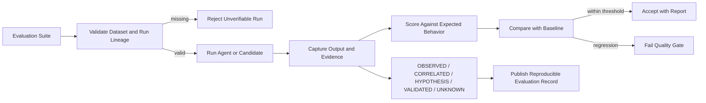

# x4-eval-harness

**Evidence-first evaluation harness for AI agents.**

Claim graphs, source ranking, verification loops, and the canonical X4 scoring path:

```
OBSERVED → CORRELATED → HYPOTHESIS → VALIDATED / UNKNOWN
```

No PASS without evidence.

<!-- X4-APEX-DIAGRAM-START:x4-eval-harness -->



<!-- X4-APEX-DIAGRAM-END:x4-eval-harness -->

## Quick Start

```bash
pip install -e ".[dev]"
python -m x4_eval_harness.run --suite examples/basic.json
```

## License

Apache-2.0
